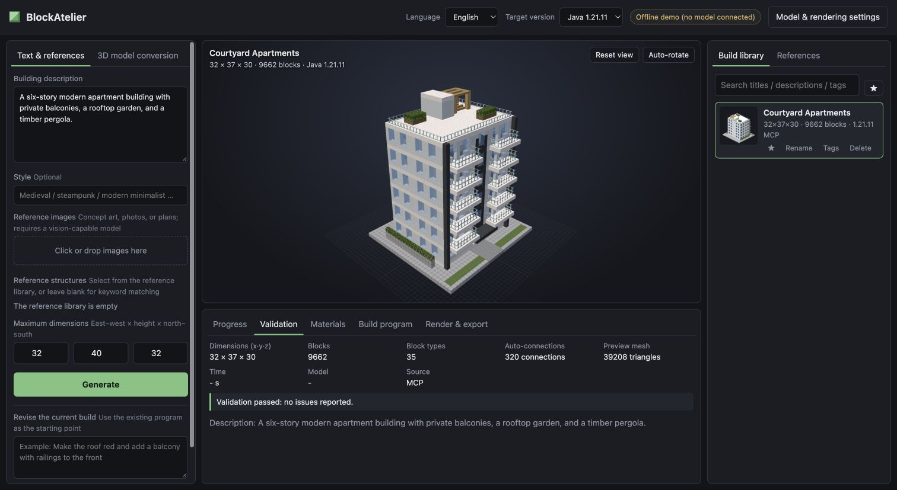
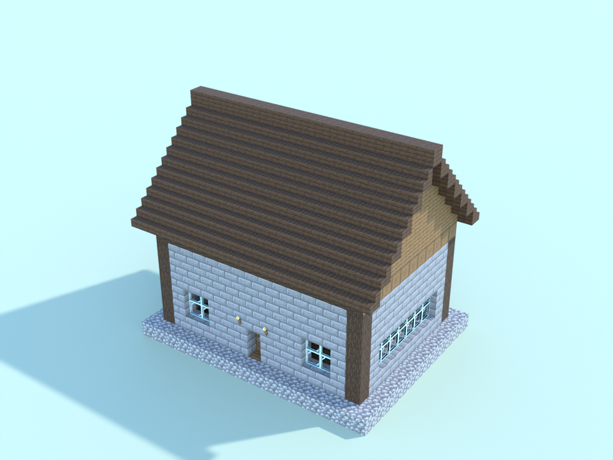

# BlockAtelier

BlockAtelier is an experimental local application for creating Minecraft Java Edition structures from text descriptions, reference images, existing structures, and 3D models. It combines a browser interface, structured building operations, validation, textured 3D previews, a local project library, and optional Blender rendering.

Builds can be exported as `.litematic`, Sponge `.schem`, and GLB files. OBJ export with textures is available for external rendering workflows.

Version: **0.5.1**. The development dataset includes profiles for **Java 26.3** (DataVersion 5023) and **1.21.11**. Game-derived version profiles are excluded from this source repository and must be prepared locally. The default configuration selects the latest locally installed profile. Compatibility with a particular game or mod installation requires separate verification.



## Features

- Generate structures from text descriptions, with optional reference images and local reference structures.
- Convert 3D models into block structures using surface sampling, voxelization, and color-based material selection.
- Execute deterministic JSON building operations for shapes, roofs, doors, patterns, transformations, and repeated components.
- Validate block identifiers, properties, dimensions, connectivity, and unsupported or gravity-sensitive blocks.
- Review textured geometry in the browser and inspect four-angle isometric previews.
- Configure structural repair and visual review rounds for model-backed generation.
- Organize builds with search, tags, favorites, and revision relationships.
- Export structure files and meshes, and render through Blender or an external workflow.
- Expose building, validation, conversion, and rendering functions through a local MCP server.

## Desktop application (macOS)

The Apple Silicon desktop build opens in a standalone macOS window and bundles its Python runtime. It supports the same bilingual interface, local generation, 3D preview, library, native file export, and optional model services. No external browser or separately installed Python is required to run the packaged app.

See [DESKTOP.md](DESKTOP.md) for installation, storage locations, build instructions, and distribution limitations. Ollama and Blender remain optional external applications. The desktop build is ad-hoc signed and has not been notarized. On first launch it downloads the Java 1.21.11 rendering profile to local application storage; the Release archive does not bundle game-derived profiles.

Download the macOS build from [GitHub Releases](https://github.com/GreatestBakery/BlockAtelier/releases/latest).

## Installation

A Python environment with the dependencies in `requirements.txt` is required. Dependency versions are currently unpinned, so interpreter and platform support depends on the packages installed. Blender is optional and is required only for Blender rendering.

Run the following commands from the project directory:

```bash
python -m pip install -r requirements.txt
python tools/update_version.py latest
python run.py
```

The profile preparation command requires network access and downloads game-derived data for local use. See [Version profiles](#version-profiles) for specific versions and offline preparation.

The application opens at [http://127.0.0.1:8765](http://127.0.0.1:8765). Keep the terminal running while using the application. Stop the server with `Ctrl+C`.

To use a different port or disable automatic browser launch:

```bash
python run.py --port 8766 --no-browser
```

The server binds to `127.0.0.1` by default. It has no authentication and is intended for local use.

### Offline demonstration mode

The initial configuration uses a local rule-based generator for a small set of building types, including houses, towers, and pavilions. This mode supports offline demonstrations and pipeline checks. It does not provide general-purpose text or image generation.

## Model configuration

If a model returns invalid JSON, the pipeline asks it once to correct the syntax while preserving the design, original request, size limits, and reference images. A second invalid response stops the stage. This correction does not retry provider errors or explicitly marked truncation.

The **Model and Rendering Settings** panel configures the provider, model identifier, API key, endpoint, visual input support, and rendering options. The interface supports **English** and **Simplified Chinese**. Use the language selector in the header to switch instantly. The initial language follows the browser preference, and an explicit selection is saved in local browser storage. Switching languages preserves form entries, selected versions, unsaved settings, and render options. User-authored descriptions, build titles, and building-program JSON retain their original text.

| Provider setting | Implemented protocol | Intended service |
|---|---|---|
| `anthropic` | Messages API | Anthropic-compatible endpoint |
| `openai` | OpenAI-compatible chat completions | OpenAI endpoint preset |
| `gemini` | OpenAI-compatible chat completions | Gemini endpoint preset |
| `deepseek` | OpenAI-compatible chat completions | DeepSeek endpoint preset |
| `qwen` | OpenAI-compatible chat completions | DashScope endpoint preset |
| `openrouter` | OpenAI-compatible chat completions | OpenRouter endpoint preset |
| `ollama` | OpenAI-compatible chat completions | Local Ollama endpoint |
| `opencode` | Local opencode 2.x CLI | Models and credentials configured in opencode |
| `codex` | Local Codex CLI | ChatGPT sign-in and the plan's Codex allowance |
| `custom` | OpenAI-compatible chat completions | Custom endpoints, including compatible LM Studio or vLLM servers |

Use a model identifier available to the configured account or local service. Reference images and visual review require a model with image input support. Disable visual processing for text-only models.

### opencode as a model source

In either the web interface or Mac app, select **opencode** in Model and Rendering Settings. Install [opencode 2.x](https://opencode.ai/docs/cli/commands/) separately and complete its provider login first. Enter a model as `provider/model` (optionally `#variant`), or leave it blank to use opencode's default. The **opencode executable** field accepts an absolute path when it is not on PATH; the Mac app also checks `~/.opencode/bin/opencode`, `/opt/homebrew/bin/opencode`, and `/usr/local/bin/opencode`.

This option calls `opencode run --format json` as the model backend for the existing generation, repair, and visual-review pipeline. Reference images are passed as file attachments when vision is enabled. Each call uses a temporary model-only agent with tool permissions disabled. API endpoint and API key fields do not apply; authentication and model settings come from opencode. Token limits and temperature are also managed by opencode. The existing MCP integration below remains available independently.

### Codex with ChatGPT sign-in

In either the web interface or Mac app, select **codex** in Model and Rendering Settings. Install Codex CLI **0.166.0 or later**, run `codex login`, and sign in with your ChatGPT account. This uses your plan's Codex allowance, subject to account/model availability and usage limits; it does not require API credits or an API key in BlockAtelier. See [OpenAI's account and usage guide](https://help.openai.com/en/articles/11369540-using-codex-with-your-chatgpt-plan).

Leave the model field blank for the CLI's built-in default, or enter a model identifier available to your ChatGPT account. The **Codex executable** field accepts an absolute path; the Mac app also checks `~/.local/bin/codex`, `/opt/homebrew/bin/codex`, and `/usr/local/bin/codex` when Finder does not supply a shell PATH. Reference images and visual review require an image-capable model.

The adapter runs `codex exec` in a temporary directory and reads only its final response. Each call is ephemeral, requires ChatGPT sign-in, uses a read-only sandbox, and disables shell, multi-agent, and web-search tools. User `config.toml` is not loaded, so custom providers and MCP servers are not started by these model calls; existing CLI authentication is retained. Model settings such as token limits and temperature use Codex defaults. Existing BlockAtelier MCP, opencode, and HTTP providers remain independent and available.

Configuration is stored in `workspace/config.json`. The following environment variables override nonempty provider settings:

| Variable | Purpose |
|---|---|
| `ATELIER_PROVIDER` | Provider identifier |
| `ATELIER_MODEL` | Model identifier |
| `ATELIER_API_KEY` | API key |
| `ATELIER_BASE_URL` | API endpoint base URL |
| `ATELIER_WORKSPACE` | Workspace location instead of the default project-local `workspace/` directory |
| `ATELIER_DATA` | Optional location for prepared version profiles; desktop mode uses its application-support directory |

API keys saved through the interface are stored in plaintext. Workspace files can also contain uploaded references, request content, and model conversations. Exclude private workspace data from public repositories and shared archives.

## MCP integration

BlockAtelier provides a local stdio MCP server. The MCP client starts the server process; the browser application does not need to be running. In this mode, the connected client's model uses the building tools directly, without a separate API key in BlockAtelier.

Configure the client with the Python executable that has the project dependencies installed and the absolute project directory as its working directory.

### Clients using JSON configuration

```json
{
  "mcpServers": {
    "blockatelier": {
      "command": "/absolute/path/to/python",
      "args": ["-m", "atelier.mcp_server"],
      "cwd": "/absolute/path/to/blockatelier"
    }
  }
}
```

### Codex configuration

Add the following table to `~/.codex/config.toml`, replacing both paths with the local installation paths:

```toml
[mcp_servers.blockatelier]
command = "/absolute/path/to/python"
args = ["-m", "atelier.mcp_server"]
cwd = "/absolute/path/to/blockatelier"
```

### opencode configuration

`opencode mcp add` cannot set a working directory, so use the `run_mcp.py` launcher, which works from any directory. Run the following command with both paths replaced; add `--global` to make the server available in every project instead of only the current one:

```bash
opencode mcp add blockatelier -- /absolute/path/to/python /absolute/path/to/blockatelier/run_mcp.py
```

The equivalent entry in `opencode.json` (project) or `~/.config/opencode/opencode.json` (global) is:

```json
{
  "$schema": "https://opencode.ai/config.json",
  "mcp": {
    "servers": {
      "blockatelier": {
        "type": "local",
        "command": ["/absolute/path/to/python", "/absolute/path/to/blockatelier/run_mcp.py"]
      }
    }
  }
}
```

This is the opencode 2.x layout. opencode 1.x uses the same server entry placed directly under `"mcp"`, without the `"servers"` level. Optional `ATELIER_*` variables go in the entry's `"environment"` object, or after `--env` on the command line. `opencode mcp list` reports whether the server connected.

The launcher is not specific to opencode: any client can start `run_mcp.py` by absolute path instead of `-m atelier.mcp_server` with a working directory.

### Desktop application as the MCP server

The macOS application bundles the MCP server, so a separate Python environment or source checkout is not required. Start its executable with `--mcp`; no window opens:

```bash
opencode mcp add blockatelier --global -- /Applications/BlockAtelier.app/Contents/MacOS/BlockAtelier --mcp
```

Other clients use the same executable as `command` and `["--mcp"]` as `args`. In this mode the tools use the application's storage in `~/Library/Application Support/BlockAtelier/`, so builds created through MCP appear in the desktop library. Open the application once first to download the rendering profile. See [DESKTOP.md](DESKTOP.md).

### One core for every entry point

The browser application (`run.py`), the desktop window and its `--mcp` mode (`run_desktop.py`), and the source MCP launchers (`run_mcp.py`, `-m atelier.mcp_server`) all run the same `atelier` package. MCP tools call the same pipeline functions as the application: `pipeline.build_from_program` for interpretation and validation, and `pipeline.finalize` for export and library records. A given building program therefore produces the same blocks, report, files, and preview through any of them. `get_build_guide` begins with the core version and whether it runs from source or from the desktop application.

The entry points differ only in where they store data: source launchers use the project-local `workspace/` and `data/` directories, and the desktop application uses its application-support directory. Set `ATELIER_WORKSPACE` and `ATELIER_DATA` to make them share one library and one set of version profiles.

Reload the client after changing its configuration. The `get_build_guide` tool provides a connection check and the supported building-operation format.

| Tool | Function |
|---|---|
| `get_build_guide` | Building-operation format and available target versions |
| `search_blocks` | Block identifiers and supported properties |
| `build_structure` | Program execution, validation, export, and four-angle preview |
| `voxelize_model` | 3D-model conversion to a saved block structure |
| `list_builds` | Saved-build listing and search |
| `get_build_program` | Retrieval of a saved building program |
| `render_build` | Rendering through a local Blender installation |
| `get_blender_script` | Script generation for execution through a separate Blender MCP connection |

## Usage

### Text and reference input

1. Select the target Minecraft profile and the maximum dimensions. Dimension order is east–west, height, and north–south (`x`, `y`, `z`).
2. Enter a building description and an optional style description.
3. Optionally attach reference images or select structures from the local reference library.
4. Start generation and inspect the process timeline, validation report, material counts, and preview.
5. Export the result or create a revision from the selected build.

Reference structures currently contribute dimensions and material proportions. They are not reconstructed or copied automatically. Reference matching uses filenames and tags. Optional web search uses a configured SearXNG instance and retrieves titles and snippets.

### 3D-model conversion

Upload a supported model and configure voxel dimensions, block palette, and optional interior filling. The upload handler accepts `.obj`, `.glb`, `.gltf`, `.stl`, `.ply`, `.off`, `.3mf`, and `.dae`; successful loading depends on trimesh and any format-specific dependencies.

For other formats, convert the source to GLB in a suitable 3D application before importing it. Surface samples are matched to block colors in CIELAB space. Interior filling works best with a closed mesh.

### Export formats

| Format | Use |
|---|---|
| `.litematic` | Litematica workflows |
| `.schem` | Sponge schematic workflows, including WorldEdit |
| `.glb` | Textured 3D preview and interchange |
| `.obj` with textures | External mesh and material workflows, including MCprep preparation |

Structure import supports `.litematic`, `.schem`, legacy `.schematic`, and vanilla `.nbt` files. The normal build pipeline exports Sponge v3 schematics; the exporter and tests also cover v2.

The selected profile determines the exported DataVersion. Use a matching game and mod version. The Litematic exporter writes format version 7 for DataVersion 3837 or later, and version 6 for earlier profiles.

## Generation pipeline

The text workflow processes the description and references into a design brief, generates a JSON building program, executes it into a voxel grid, and validates the result. Configured repair rounds address reported structural problems. Optional visual review evaluates the four-angle preview and can produce a revised program.

The model-conversion workflow samples the source mesh, creates voxels, selects blocks by color, optionally remaps materials, and validates the resulting structure.

Both workflows export the final structure and mesh, generate previews, and save a library record. Blender rendering and additional mesh export are available after generation.

### Building operations

The interpreter in `atelier/dsl.py` supports `box`, `sphere`, `cylinder`, `cone`, `pyramid`, `roof`, `line`, `set`, `pattern`, `replace`, `door`, and `group` operations. Groups support translation, rotation, mirroring, and repetition.

Structured operations provide a compact representation for large builds and deterministic execution. Directional block properties are transformed with the geometry. Roof operations assign stair directions, while fences, walls, panes, and iron bars receive automatic neighbor connections.

An example program is included in [examples/sample_program.json](examples/sample_program.json).

## Rendering

### Browser and isometric previews

The browser uses bundled three.js modules and textured geometry derived from blockstates and models. Thumbnail generation and visual review use a separate flat-color isometric renderer. These previews simplify some block shapes and do not reproduce all in-game rendering behavior.

### Blender

Install Blender and configure its executable path in the settings panel. A compatible `bpy` installation is an alternative for headless rendering, subject to its Python and platform requirements.

Use the rendering panel or run:

```bash
blender -b -P atelier/render/blender_job.py -- --glb /path/to/model.glb --out /path/to/render.png
```

The rendering script configures texture sampling, lighting, ground, and camera framing. Multi-angle output is supported through render options.



### External workflows

A separate Blender MCP connection can execute the script returned by `get_blender_script`. OBJ exports use texture-based material names for further preparation in MCprep.

Chunky and Mineways operate on world saves. Structures must first be placed in a world using a compatible tool such as WorldEdit or Litematica. BlockAtelier does not generate world saves; its external-rendering module provides command helpers rather than a complete world-based integration.

## Version profiles

Profiles are stored locally under `data/versions/<version>/` and are ignored by Git. Textured example GLB and OBJ meshes are also excluded from the source repository. Each profile contains `version.json`, `blocks.json`, `blockstates.json`, `models.json`, `atlas.json`, `atlas.png`, and `colors.json`.

To download a profile for the latest release available from the configured data source:

```bash
python tools/update_version.py latest
```

For a specific supported version, replace `latest` with its version identifier. An offline source directory can be supplied with `--from-dir`:

```bash
python tools/update_version.py 1.21.11 --from-dir /path/to/mcmeta-mirror
```

The update utility retrieves version metadata, block properties, blockstates, models, and textures from misode/mcmeta. Available profiles are exposed in the application. Profile availability depends on the upstream data source; adding a profile does not establish compatibility with every corresponding mod release.

## Project structure

| Path | Responsibility |
|---|---|
| `run.py` | Local application launcher |
| `web/` | Bilingual browser interface, frontend localization, and bundled three.js modules |
| `atelier/server.py` | FastAPI endpoints, background jobs, uploads, and downloads |
| `atelier/pipeline.py` | Generation, validation, repair, visual review, and export orchestration |
| `atelier/llm/` | Provider adapters and offline rule-based generation |
| `run_mcp.py` | MCP server launcher that works from any working directory |
| `atelier/mcp_server.py` | Local MCP tools |
| `atelier/dsl.py` | Building-operation interpreter |
| `atelier/voxel.py` | Sparse voxel storage |
| `atelier/validate.py` | Block and structure validation |
| `atelier/blocks.py` | Version profiles, properties, aliases, and block lookup |
| `atelier/references.py` | Local reference processing and search |
| `atelier/meshvox.py` | Model sampling, voxelization, and color matching |
| `atelier/importers.py` | Structure import |
| `atelier/exporters/` | Litematic and Sponge schematic export |
| `atelier/mesh.py` | Block-model baking and mesh export |
| `atelier/render/` | Isometric previews, Blender jobs, and external-rendering helpers |
| `atelier/store.py` | File-based build storage and SQLite library index |
| `data/versions/` | Installed version profiles and game-derived resources |
| `tools/update_version.py` | Version-profile download and preparation |
| `tests/` | Python tests and schematic interoperability checks |
| `examples/` | Example programs, meshes, and screenshots |
| `workspace/` | Local configuration, uploads, references, builds, and library database |

### Workspace outputs

Builds are stored in `workspace/builds/<id>/`. Depending on the workflow and completed stages, a directory can include:

| File | Contents |
|---|---|
| `request.json` | Original build request |
| `brief.json` | Generated design brief |
| `program.json` | Executable building program |
| `llm_log.json` | Model request and response history |
| `build.litematic` | Litematica structure |
| `build.schem` | Sponge schematic |
| `model.glb` | Textured mesh |
| `preview.png` | Four-angle preview |
| `thumb.png` | Library thumbnail |
| `render_*.png` | Optional rendered images |

Library metadata is indexed in `workspace/library.db`. Build files remain accessible as ordinary files and can be copied independently.

## Testing and validation

The test suite expects locally prepared profiles for `26.3` and `1.21.11`. Prepare these once using `python tools/update_version.py 26.3` and `python tools/update_version.py 1.21.11`, or an offline mirror. Profile preparation may require network access; the Python tests themselves use local fixtures.

Run the offline Python suite from the project directory:

```bash
python -m pytest tests -q
```

The suite covers version profiles, geometry operations, transformations, validation, block connections, Litematic decoding, schematic round trips, mesh export, voxel colors, local provider-protocol fixtures, repair behavior, and library operations. Frontend language preference, fallback, and diagnostic translations can be tested separately with Node.js:

```bash
node --experimental-vm-modules tests/i18n.test.mjs
```

Independent schematic checks are provided under `tests/crosscheck/` for schematicjs and prismarine-schematic; these require their own JavaScript dependencies and are not part of the Python test command.

Bundled screenshots and render examples document previous interface and rendering checks. They are not a guarantee of compatibility on every platform. Live model-provider calls, loading in an actual game, and external tools require separate integration testing. Local protocol fixtures do not establish successful authentication or behavior against a live provider.

## Limitations

### Generation and references

- Structural validation checks technical constraints; it does not guarantee architectural quality, playability, or a complete interior.
- Large building programs can exceed a model's output limit. Truncation is detected, but generation is not yet split into separate component requests.
- Visual review uses simplified isometric images, which limit assessment of stairs, slabs, and small details.
- Reference structures provide dimensions and material proportions, without extracted silhouettes or floor plans.
- Reference search uses keyword matching. Automatic structure downloads from third-party building sites are not implemented.
- Optional online reference search requires SearXNG and uses titles and snippets rather than downloaded structures.

### Blocks and formats

- Block-entity payloads are not exported. Chest contents, sign text, and banner patterns are not preserved; some preview representations use substitutes.
- Stair corner shapes are not inferred automatically, wall connections use low heights, and model `uvlock` is not implemented.
- Imports do not perform cross-version data upgrades. Blocks absent from the selected profile can be omitted and reported.
- Biome tinting uses fixed plains-style colors. Emissive materials and volumetric water are not implemented.

### Model conversion and performance

- Features smaller than one block can disappear during voxelization.
- Material matching uses average color rather than texture patterns and does not use dithering. Baked lighting in source textures can affect color selection.
- Interior filling depends on mesh closure and can fail for open or damaged surfaces.
- Geometry interpretation and mesh generation use Python loops. Large structures can require substantial processing time and memory.
- Dependencies are not version-locked. Reproducible distribution requires a separately maintained environment or lockfile.

## Dependencies and acknowledgments

Core dependencies include NumPy, SciPy, Pillow, trimesh, nbtlib, litemapy, FastAPI, Uvicorn, and python-multipart. MCP support uses the MCP Python SDK; tests use pytest. The browser bundles three.js. Blender is an optional external renderer, and misode/mcmeta supplies version-profile source data.

Related tools and approaches include WorldEdit, Litematica, Mineways, jmc2obj, MCprep, Chunky, ObjToSchematic, BlockBlender, deepslate, prismarine-viewer, BuilderGPT, T2BM, and APT. Mentioning these projects does not imply bundled code, endorsement, or a tested integration.

Dependency versions, license notices, resource provenance, and external-tool distinctions are recorded in [THIRD_PARTY_NOTICES.md](THIRD_PARTY_NOTICES.md). Full direct-dependency notices are included in [LICENSES/](LICENSES/), and the bundled three.js license is available at [web/vendor/LICENSE](web/vendor/LICENSE).

## License

Copyright (C) 2026 getbake and BlockAtelier contributors.

Original project source code and documentation are licensed under **GNU GPL version 3 only**, identified as **GPL-3.0-only**. See [LICENSE](LICENSE) for the complete terms and [COPYRIGHT](COPYRIGHT) for the scope of the grant. The software is provided without warranty. Third-party components retain their respective licenses.

Minecraft textures, models, and other game-derived resources are outside the project's source-code license grant. Public distributions must exclude resources without an applicable redistribution permission. Exported meshes, textures, and example assets must be assessed according to their contents. User-provided and generated content does not automatically become GPL-licensed through use of the application.

Minecraft resources remain subject to the [Minecraft EULA](https://www.minecraft.net/en-us/eula) and [Minecraft Usage Guidelines](https://www.minecraft.net/en-us/usage-guidelines).

BlockAtelier is an independent, unofficial project. It is not affiliated with, endorsed by, or approved by Mojang or Microsoft.
